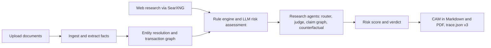

# Intelli-Credit

Intelli-Credit is a local credit appraisal engine for Indian MSME and corporate loans. It reads borrower documents, researches the company on the open web, builds a transaction graph and checks it for fraud patterns, applies a set of deterministic risk rules, and writes a Credit Appraisal Memo (CAM) with a full decision trace.

Manual underwriting means reading PDFs, reconciling GST returns against bank statements, searching for news on the promoters, and writing the memo by hand. That takes days and is hard to audit afterwards. Intelli-Credit runs the same steps in one pipeline, streams progress to the browser, and records why every point of risk was added. All model inference runs locally through Ollama, so borrower documents never leave the machine.

The project was built for a national AI/ML hackathon hosted at IIT Hyderabad. The original problem statement and early research notes are in [`problem_statement_and_initial_research/`](problem_statement_and_initial_research/).

## Key features

- **Document ingestion** of PDF (PyMuPDF), Markdown, JSON and text files, with regex extractors for GST figures, CIBIL CMR, days past due, collateral cover, capacity utilisation, promoter details and revenue.
- **Web research agents** that plan search queries with an LLM, search through a self-hosted SearXNG instance, drop results from 26 noise domains, and weight sources with a 25-entry confidence map (for example `rbi.org.in` at 0.95, `wikipedia.org` at 0.50).
- **Evidence judging**: precision@10 and cross-source corroboration scores for every finding, plus a claim graph that flags contradictions between sources.
- **Counterfactuals** that show how the risk score would change if a key fact were different (for example, DPD of 0 instead of 120).
- **Transaction graph analysis** with NetworkX cycle detection and a 2-layer GCN (PyTorch Geometric) that labels a network as `clean`, `ring`, `star_seller`, `dense_cluster` or `layered_chain`.
- **In-browser GNN**: the same model exported to ONNX runs in the UI through ONNX Runtime Web, so you can edit node features in the Graph Playground and see the classification update without calling the backend.
- **10 YAML risk rules** (in [`rules/`](rules/)) covering GST ITC mismatch, circular trading, DPD, dishonoured cheques, CIBIL CMR, revenue inflation, promoter litigation, capacity utilisation, sector headwinds and collateral coverage. Each rule adds a graded risk adjustment, and circular trading is configured as a hard reject.
- **CAM output** as Markdown and as a multi-page ReportLab PDF with the verdict, a risk gauge, rule breakdown, evidence metrics and a counterfactual appendix.
- **Live progress** over Server-Sent Events, a portfolio dashboard, side-by-side comparison of up to 5 cases, and officer notes with tags and pinning.
- **AutoFetch**: generate a starter `facts.md` for a new company from web research when you have no documents yet.

## How it works



A run goes through these steps, all orchestrated by [`services/pipeline.py`](services/pipeline.py):

1. **Ingestion**: parse documents, extract structured facts, load transactions into DuckDB and log provenance.
2. **Research**: the research agent searches the web for the company and its promoters.
3. **Entity resolution**: RapidFuzz matches counterparties whose names are spelled differently across filings.
4. **Graph analysis**: build the transaction graph, find cycles, and classify the topology with the GNN.
5. **Reasoning**: fire the YAML rules against the extracted facts and ask DeepSeek-R1 for a risk classification.
6. **Agents**: plan follow-up queries, score evidence, build the claim graph and generate counterfactuals.
7. **Decision**: combine the signals into a risk score, write the CAM and save a schema v3 trace.

### Risk scoring

The score is a sum of independent signals, clamped to the range 0 to 1:

| Signal | Contribution |
|---|---|
| Base prior | 0.15 |
| LLM risk class | LOW 0.00, MEDIUM 0.10, HIGH 0.25, CRITICAL 0.40 (MEDIUM if the LLM is unavailable) |
| GNN topology | ring 0.15, dense_cluster 0.12, star_seller 0.08, layered_chain 0.05 |
| Negative research | 0.05 if there are 3 or more negative findings |
| Rule firings | the `risk_adjustment` of each rule that fired |

A score above 0.70 gives REJECT, above 0.50 gives CONDITIONAL, and anything lower gives APPROVE. Any rule marked `hard_reject` forces a REJECT regardless of the score.

## Tech stack

| Area | Tools |
|---|---|
| API | FastAPI, Uvicorn, sse-starlette |
| LLMs (via Ollama) | DeepSeek-R1 8B Llama distill (Q8) for reasoning, Llama 3.2 3B for the research agents |
| Search | SearXNG (Docker) |
| Data and graphs | DuckDB, NetworkX, PyTorch Geometric, RapidFuzz |
| Documents | PyMuPDF, ReportLab |
| Frontend | React 18, Vite 5, React Router, Tailwind CSS, Recharts, D3 |
| Browser ML | ONNX Runtime Web |
| Testing | pytest, Vitest with happy-dom, Playwright |

## Getting started

### Prerequisites

- Linux or WSL2, Python 3.12, Node.js 18+, Docker
- [Ollama](https://ollama.com) with these models available:
  - `sjo/deepseek-r1-8b-llama-distill-abliterated-q8_0:latest`
  - `llama3.2:3b`
- A GPU is recommended for the LLMs (the DeepSeek model needs around 8 GB of VRAM)

### Install

```bash
git clone https://github.com/Aqwerty321/Intelli-Credit.git
cd Intelli-Credit

python3.12 -m venv .venv && source .venv/bin/activate
pip install -r requirements.txt
# PyTorch and PyTorch Geometric are installed separately (see the notes at the end of requirements.txt)
pip install torch torchvision --index-url https://download.pytorch.org/whl/cu130
pip install torch-geometric

cd frontend && npm install && cd ..   # postinstall copies the ONNX Runtime WASM files into public/models
```

### Configure

Set these environment variables if the defaults do not match your setup:

| Variable | Purpose |
|---|---|
| `OLLAMA_HOST` | Ollama API endpoint (the default points at a WSL host address, so most setups need to set this) |
| `SEARXNG_URL` | SearXNG endpoint, default `http://localhost:8888` |
| `GLM_OCR_MODEL` | Optional Ollama model used for OCR on scanned PDFs |
| `VITE_PRESENTATION_MODE` | Set to `1` to hide the sidebar and debug views for demos |

### Run

```bash
./scripts/start.sh                 # starts SearXNG (docker compose), the API on :8000 and Vite on :5173
./scripts/start.sh --no-frontend   # API only
```

Then open http://localhost:5173. The API docs are at http://localhost:8000/docs, and `curl http://localhost:8000/health` should return `{"status": "ok", "version": "3.0.0"}`.

On first start the backend seeds three demo cases from `demo/seed/` and runs the pipeline on them. They ship with documents, transactions and pre-built research caches, so you can explore the UI without live web research.

| Company | Verdict | Risk | Rules fired | What it shows |
|---|---|---|---|---|
| Sunrise Textiles Pvt Ltd | APPROVE | 0.25 | 0 | Clean profile: CMR 3, zero DPD, GST matches, 78% capacity, 1.6x collateral |
| Apex Steel Components Ltd | CONDITIONAL | 0.65 | 3 | Borderline: CMR 6, DPD 45 and 33% excess ITC each add risk |
| Greenfield Pharma Industries Pvt Ltd | REJECT | 1.00 | 9 | CMR 9, DPD 120, circular trading, criminal cases on the promoter, 25% capacity |

### Tests

```bash
python -m pytest tests/          # 231 backend tests (or ./scripts/run_acceptance.sh)
cd frontend && npm test          # 37 frontend tests
cd frontend && npm run e2e       # Playwright, needs the servers from start.sh running
```

`./scripts/judge_pack.sh` runs the test suite, a demo showdown and writes a scorecard to `reports/`.

## API overview

Base URL `http://localhost:8000`. The full schema is at `/docs`.

| Endpoint | Purpose |
|---|---|
| `GET, POST /api/cases/` | List or create cases |
| `GET, DELETE /api/cases/{id}` | Case detail, or delete a case and its files |
| `POST /api/cases/{id}/documents` | Upload a document |
| `GET /api/cases/{id}/cam`, `/cam/pdf` | Download the CAM as Markdown or PDF |
| `GET /api/cases/{id}/graph` | Graph nodes, edges, GNN result and cycles |
| `GET, POST, PATCH, DELETE /api/cases/{id}/notes` | Officer notes |
| `GET /api/cases/stats/dashboard` | Portfolio statistics |
| `GET /api/cases/compare/bulk?ids=a,b,c` | Compare up to 5 cases |
| `GET /api/run/{id}/stream` | Run the pipeline and stream SSE events |
| `POST /api/run/{id}` | Run the pipeline synchronously |
| `GET /api/autofetch/{id}/stream` | Research a company and generate `facts.md` |

The stream emits `progress`, `research_complete`, `research_plan_ready`, `evidence_scored`, `claim_graph_ready`, `counterfactual_ready`, `warning`, `complete` and `error` events.

## Project structure

```
app/          FastAPI app, demo case seeding, case/run/autofetch routes
services/     Pipeline, ingestion, lakehouse, entity resolution, graph + GNN, rules, agents, CAM
rules/        10 YAML risk rules
frontend/     React + Vite UI, charts, panels, ONNX model, Vitest and Playwright tests
demo/         Seed cases and intelligence demo pack
tests/        Backend unit and integration tests
acceptance/   Acceptance checks (extraction, research depth, explainability, memory, VRAM)
scripts/      Startup, test, demo and ONNX export scripts
templates/    CAM document template
docs/         Feature access matrix
```

Runtime data (cases, research caches, the DuckDB file) is written to `storage/`, which is git-ignored.

## Further reading

- [`PRESENTATION.md`](PRESENTATION.md): architecture diagrams from the hackathon presentation
- [`VISION.md`](VISION.md): the original target architecture
- [`docs/feature_access_matrix.md`](docs/feature_access_matrix.md): which UI element calls which endpoint
- [`LEGAL.md`](LEGAL.md): crawling and data governance policy

## Limitations

- This is a research prototype, not a production lending system. Verdicts on the demo cases are deterministic, but live runs depend on LLM output and current web results.
- Live research needs both Ollama and SearXNG running. Research caching is currently disabled, so each run fetches fresh results.
- The vision and presentation documents describe some components (LanceDB, PyReason, Firecrawl, Crocodile) that are planned but not part of the current pipeline.

## License

MIT. See [LICENSE](LICENSE).
